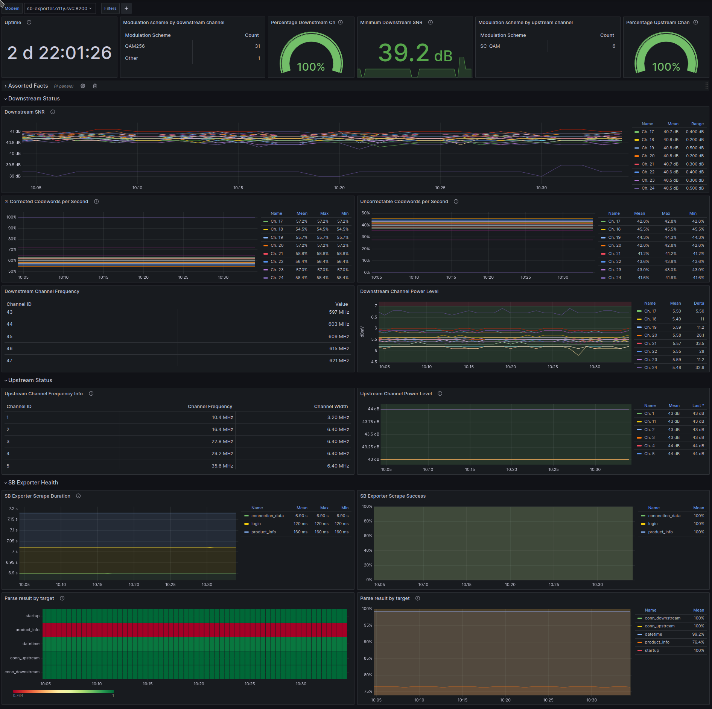

# SB8200 prometheus exporter

[Yet another](#prior-work) SB8200 prometheus exporter.
This implementation does not require a headless browser and exports in prometheus format.
It's simple and meant to be deployed in a k8s cluster but can be run locally; all configuration is done via environment variables.

<!-- maintained with yzhang.markdown-all-in-one -->
- [SB8200 prometheus exporter](#sb8200-prometheus-exporter)
  - [Configuration](#configuration)
  - [Dashboard](#dashboard)
  - [Prior work](#prior-work)
  - [Deployment](#deployment)
  - [Development](#development)
  - [Releases](#releases)

## Configuration

| Environment variable            | Default                 | Purpose                                                                       |
| ------------------------------- | ----------------------- | ----------------------------------------------------------------------------- |
| `MODEM_BASE_URL`                | `https://192.168.100.1` | Modem management URL.                                                         |
| `MODEM_USERNAME`                | `admin`                 | Modem login name.                                                             |
| `MODEM_PASSWORD`                | None; required          | Modem password.                                                               |
| `METRICS_PORT`                  | `8200`                  | Prometheus exporter listen port.                                              |
| `METRICS_HOST`                  | `::`                    | Metrics bind address. Use `0.0.0.0` for IPv4-only or `::1` for IPv6 loopback. |
| `METRICS_NAMESPACE`             | `sb8200`                | Prefix for modem metrics.                                                     |
| `METRICS_POLL_INTERVAL_SECONDS` | `60`                    | Delay between regular modem polls and slow retries.                           |
| `RE_LOGIN_INTERVAL_SECONDS`     | `5`                     | Delay between fast retries of the modem's transient login 401.                |
| `LOGIN_401_MAX_RETRIES`         | `2`                     | Number of fast 401 retries before falling back to the regular poll interval.  |
| `MODEM_REQUEST_TIMEOUT_SECONDS` | `30`                    | Total timeout for each modem HTTP request.                                    |
| `LOG_LEVEL`                     | `INFO`                  | Python log level name.                                                        |

The metrics listener defaults to the IPv6 wildcard address (`METRICS_HOST=::`).
On systems configured to accept IPv4-mapped connections, this also serves IPv4; dual-stack behavior depends on the host's IPv6 socket settings.
Set `METRICS_HOST=0.0.0.0` for an IPv4-only host.
Use an unbracketed address for `METRICS_HOST` and brackets in URLs, for example `http://[::1]:8200/metrics`.

`METRICS_NAMESPACE` is read at startup and must match `[a-zA-Z_][a-zA-Z0-9_]*`.
Changing it also changes the state-label names of enum metrics; update dashboard queries and alerts that reference `sb8200_` accordingly.
Exporter health metrics keep their `meta_` prefix, and Python/process metrics are unaffected.

At present, `DOCSIS 3.1 Operations Support System Interface Specification (CM-SP-OSSIv3.1) - Section 7.2.1 (Cable Modem Management Requirements)` does not explicitly cover what a modem is supposed to do for IPv6 management IPs but if that ever does change something like `MODEM_BASE_URL=https://[2001:db8::1]` should work.

## Dashboard

It looks like this:



And the dashboard is in [`dashboards/sb8200.json`](dashboards/sb-exporter.json)

## Prior work

There's a few other projects that do similar things but they're either old/abandoned, require a headless browser, export in a non-prometheus format or target a different modem.

I don't want to run a headless browser in my k8s cluster and I want to use prometheus so I wrote this.

- [https://github.com/sbrudenell/sb8200_exporter](https://github.com/sbrudenell/-sb8200_exporter/)

- [https://github.com/raleighlittles/ArrisCableModemMonitoring](https://github.com/raleighlittles/ArrisCableModemMonitoring)

- [https://github.com/raleighlittles/ArrisCableModemMonitoring](https://github.com/raleighlittles/ArrisCableModemMonitoring)

- [https://github.com/iwvelando/modem-scraper](https://github.com/iwvelando/modem-scraper)

- [arris_exporter command - github.com/christianclinton/arris_exporter/cmd/arris_exporter - Go Packages](https://pkg.go.dev/github.com/christianclinton/arris_exporter@v0.0.0-20181110054855-7f6ab5b91ad2/cmd/arris_exporter)

- [Monitoring Connect Box cable modems with Prometheus and Grafana | MB's Blog](https://mbugert.de/posts/2020-04-19-connectbox-prometheus/)

## Deployment

This is meant to be run in a k8s cluster with [Prometheus Operator](https://github.com/prometheus-operator/prometheus-operator).

Example manifest and deployment instructions are in [`infra/k8s`](infra/k8s/readme.md)

## Development

Standard Python 3.15 / `uv` project.
To help with dashboard development, there is a [`docker-compose`](dashboards/docker-compose.yaml) file that will start a local instance of prometheus, grafana and the exporter.

```shell
mise install
mise run test
mise run lint
mise run lint:markdown
mise run scrape
mise run docs:diagram
```

The diagram task runs the pinned KubeDiagrams image with Docker, falling back to Podman when Docker is unavailable; set `CONTAINER_RUNTIME` to override it.
Python and Graphviz for diagram generation stay inside the container.
The generated diagram is `infra/k8s/deployment.png`.

### Beads upgrades

Beads manages durable project data separately from Git. Before upgrading, make a
Dolt-native backup with the currently installed version; a JSONL export does not
preserve database history:

```shell
bd backup init /absolute/path/outside-the-checkout/beads-backup
bd backup sync
bd backup status
```

Use an existing backup destination if one is already configured, and test recovery
in a separate directory before relying on it. Verify that server-backed workspaces
back up and sync the active database, not a stale local copy.

For the 1.3.2 to 1.3.4 upgrade, read the
[upstream upgrade notes and known issues](https://github.com/gastownhall/beads/blob/v1.3.4/CHANGELOG.md).
There is no new schema migration or embedded Dolt engine change in this range.
However, the following precautions still apply:

- If the store crossed migration 0059 under Beads 1.3.0 or later, run
  `bd recompute-blocked` once per workspace after backing up.
- Do not run `bd compact` or `bd flatten` on a clone that adopted migration 0062
  through pull/bootstrap or was cloned afterward. Version 1.3.4 still lacks the
  [event-history restoration fix](https://github.com/gastownhall/beads/issues/7039);
  those commands can remove history needed for recovery.
- Review shared configuration endpoints before supplying credentials. Move keys
  no longer accepted in `.beads/.env` to the shell environment or user config.
  `mail.delegate` must also be configured per user.
- Use full issue IDs with `bd delete`. `bd rules compact` now previews by default
  and requires `--force` to apply; review its output before doing so.
- For server-backed workspaces, consult the upstream workarounds before any remote
  reset. Changing the binary version cannot restore lost database history.

## Releases

[Release Please](https://github.com/googleapis/release-please-action) maintains a release PR after changes land on `main`.
Use Conventional Commits in merge/squash commit messages: `fix:` produces a patch release, `feat:` a minor release, and `feat!:` or a `BREAKING CHANGE:` footer a major release.
The old Release Drafter labels no longer control version bumps or automatically label PRs.

The release PR updates `pyproject.toml`, the `sb-exporter` entry in `uv.lock`, `app/util/version.py`, `.release-please-manifest.json`, and `CHANGELOG.md` together.
The Python strategy discovers `version.py` automatically; the lockfile uses a package-name selector so dependency versions stay unchanged.
The selector uses `name.value` because the pinned release-please TOML parser wraps scalar values with position metadata.
The runtime version is included in the startup log and copied into the container with the application source.
Tests check that project metadata, lockfile, manifest, and runtime versions agree.
The migration baseline is the existing `v1.0.2` release; older notes remain in [GitHub Releases](https://github.com/kquinsland/sb820_prometheus_exporter/releases).

Make the organization secret `RELEASE_PLEASE_TOKEN` available to this repository before enabling the workflow.
For a fine-grained PAT, grant this repository Contents, Pull requests, and Issues read/write access, and ensure the token owner can create PRs and releases.
The workflow deliberately requires this token: the built-in `GITHUB_TOKEN` would suppress CI on generated PRs and the downstream release workflow.

Review the generated PR and wait for its checks before merging it.
Merging publishes a `vX.Y.Z` tag and GitHub release; the `Handle Release` workflow then runs lint/tests and publishes the container from that tag with Docker's version tags and OCI metadata.
Do not manually publish a Release Drafter draft; discard any stale draft left from the old workflow.
To retry release automation, dispatch `Release Please` on `main`.
To retry a container build, dispatch `Handle Release` using the released tag as the workflow ref.
